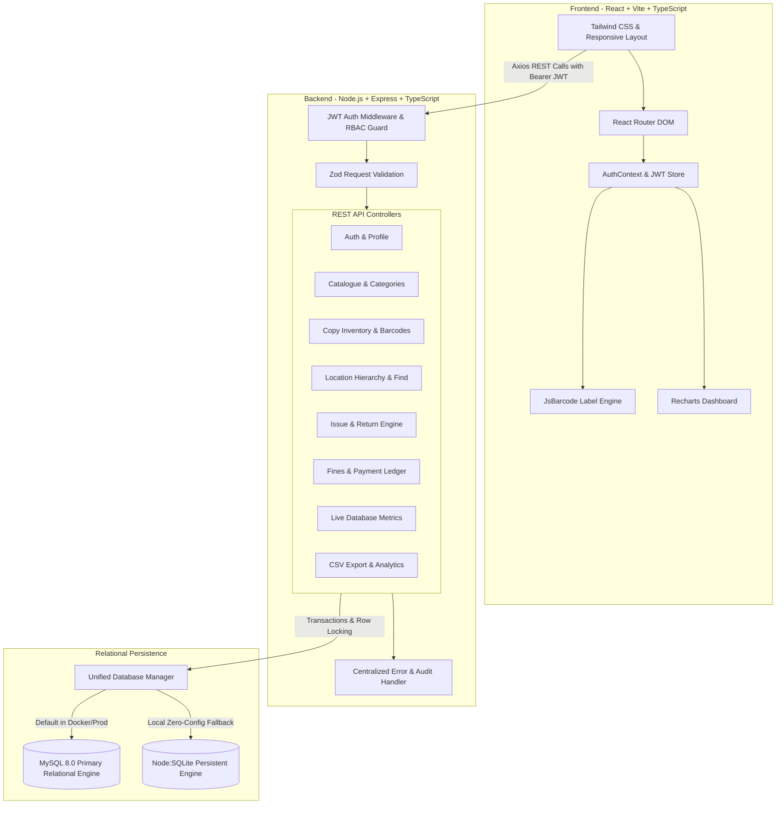

# System Architecture

## Architecture Overview
The Smart Library Management System is architectured as a multi-tier, decoupled full-stack web application designed for high availability, transactional reliability, and concurrent inventory tracking.

---

## Component Interaction Flow
1. **User Authentication**: Client submits credentials → `auth.controller` checks bcrypt hash → signs 24h JWT containing user role, student ID, and full name.
2. **Location Tracking**: User queries title → `location.controller` performs multi-table JOIN across `books`, `book_copies`, `shelves`, `racks`, `sections`, and `floors` → returns full hierarchical physical path.
3. **Issue Operation**: Concurrency check with `FOR UPDATE` lock → checks student active status, loan limits, and overdue restrictions → inserts `loans` record → marks copy `Issued` in atomic transaction.
4. **Return Operation**: Finds active loan → calculates overdue duration and daily fine → updates loan `Returned` → updates copy status → returns designated storage location coordinates for physical shelving.
