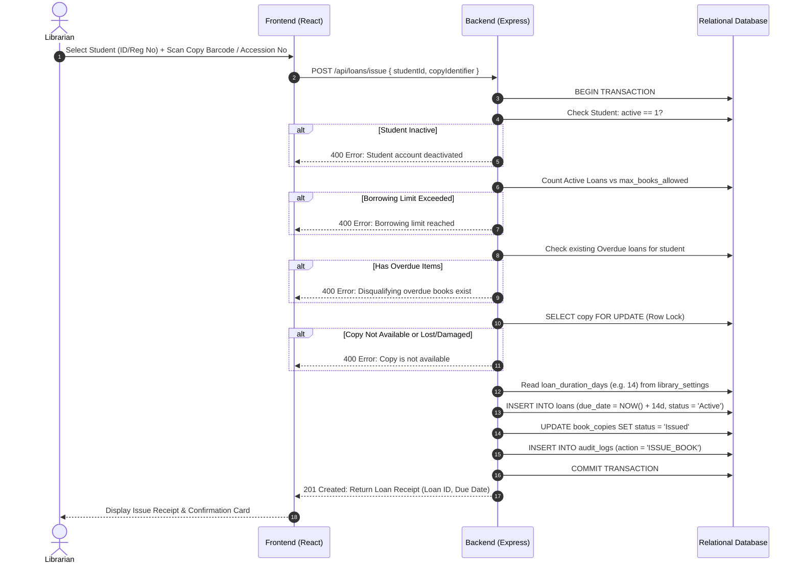
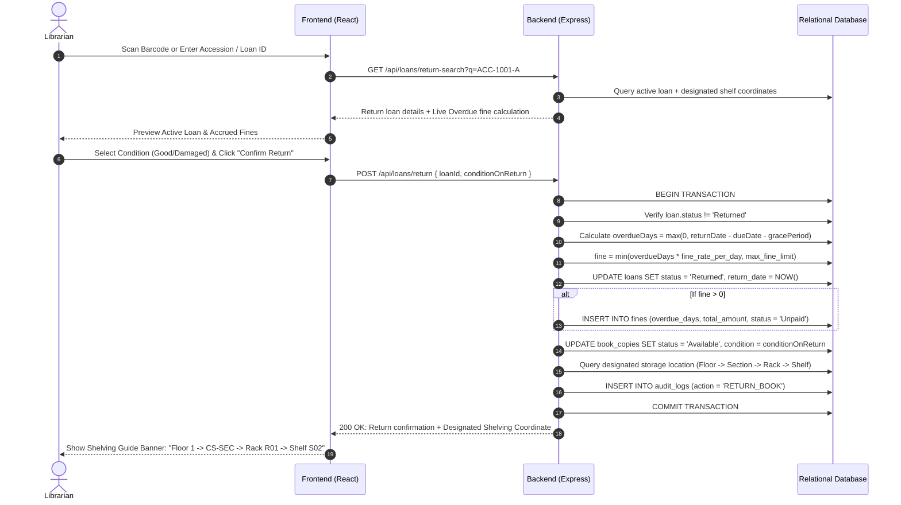

# Issue and Return Workflow

## 1. Book Issue Workflow
The issue operation transitions an available physical book copy into an active loan.

---

## 2. Book Return Workflow & Shelving Guide
The return workflow recalculates overdue durations, settles fines, and directs the librarian to the copy's designated shelf location.

